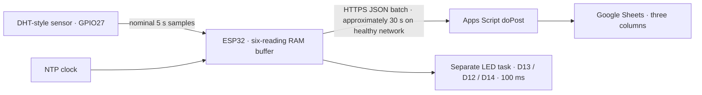

# PIA ESP32 DHT

An educational ESP32 project developed from a single blinking LED into a temperature and relative-humidity logger with a Google Apps Script / Google Sheets receiver.

**Prototype, not a completed cloud logger.** GPIO27 sensor readings and USB uploads have been demonstrated. The most recent hardware test could not connect to WiFi; earlier uploads reached Google but returned HTTP 403. End-to-end live sensor logging to Sheets has **not** been verified.

## What it does

- Reads a three-pin DHT-style module on **GPIO27** at a nominal **5-second** interval.
- Buffers **six readings** and attempts one HTTPS upload per batch.
- Runs a **100 ms** LED ping-pong pattern independently: **D13 → D12 → D14 → D12 → …**
- Provides an Apps Script receiver that writes **Timestamp | Temperature | Humidity**.
- Includes the earlier standalone LED exercises and a GPIO diagnostic.

The module was called “DHT12” during development. Its appearance also resembles a DHT11 breakout; its exact model is not confirmed. The preserved custom decoder uses integer/fraction byte decoding. Do not assume it supports DHT22 or an I²C-only DHT12 module.

## Architecture



**Sampling is not uploading:** six 5-second samples normally produce a batch approximately every 30 seconds. Blocking WiFi/HTTPS operations can lengthen the interval. No hard real-time or lossless logging guarantee is implemented.

## Hardware and wiring

Use a classic ESP32 development board, a USB data cable, the DHT module, three LEDs, and one **220–330 Ω resistor per LED**.

| Connection | ESP32 |
|---|---|
| DHT `S` / signal | **D27 / GPIO27** |
| DHT `+` / VCC | **3V3** |
| DHT `−` / ground | **GND** |
| LED 1 anode through resistor | **D13 / GPIO13** |
| LED 2 anode through resistor | **D12 / GPIO12** |
| LED 3 anode through resistor | **D14 / GPIO14** |
| All LED cathodes | **GND** |

Power off before changing wiring. GPIO pins are **3.3 V**, not 5 V tolerant. GPIO34 was originally proposed but cannot provide the sensor's start pulse because it is input-only. GPIO12 is a boot-strapping pin: do not externally pull it HIGH at reset. Board header placement varies; check the actual board pinout, not a generic hole count.

See [wiring and troubleshooting](docs/WIRING.md).

## Repository contents

| Path | Purpose |
|---|---|
| `src/main.cpp` | Preserved sensor, WiFi, batching and LED firmware |
| `include/config.example.h` | Safe WiFi/web-app configuration template |
| `platformio.ini` | Logger and individual LED build environments |
| `examples/` | Blink, forward-running, ping-pong and diagnostic sketches |
| `apps-script/Code.gs` | Google Sheets receiver, with a placeholder Sheet ID |
| `apps-script/appsscript.json` | Web-app manifest and Malaysia timezone |
| `apps-script/.clasp.example.json` | Script-project mapping template |
| `tests/` | Local receiver tests using mocked Apps Script services |
| `docs/DEVELOPMENT.md` | Development stages, decisions and corrected conclusions |
| `docs/PROGRAM.md` | Function-by-function program explanation |
| `docs/SETUP.md` | Complete setup, build, upload and deployment steps |
| `docs/SECURITY.md` | Prototype security and reliability limitations |

## Quick start

Install [PlatformIO Core](https://docs.platformio.org/en/latest/core/installation/index.html), Git and Node.js (for local script tests; clasp is optional).

```bash
git clone https://github.com/fathur6/pia-esp32-dht.git
cd pia-esp32-dht
cp include/config.example.h include/config.h
```

Edit the ignored `include/config.h` with a **2.4 GHz WPA2-PSK** SSID/password and your own deployed Apps Script `/exec` URL. Do not commit that file.

```bash
pio run -e dht12
pio device list
pio run -e dht12 -t upload --upload-port /dev/cu.YOUR_USB_PORT
pio device monitor --port /dev/cu.YOUR_USB_PORT --baud 115200
```

On Linux, ports commonly look like `/dev/ttyUSB0`; on Windows use the board's COM port. If automatic reset fails, follow the board's BOOT/EN procedure.

For a standalone LED exercise:

```bash
pio run -e blink -t upload
pio run -e forward -t upload
pio run -e pingpong200 -t upload
pio run -e pingpong100 -t upload
```

Each command replaces the program currently on the MCU. Run only the exercise desired. See `platformio.ini` for all available environments.

## Google Sheets setup

1. Create a spreadsheet and prepare `Timestamp`, `Temperature`, `Humidity` in row 1.
2. Copy `apps-script/Code.gs` into an Apps Script project.
3. Replace `YOUR_SPREADSHEET_ID` and configure the actual **sheet tab name**. The spreadsheet document title is not necessarily the tab name.
4. Authorize the script as its owner. `testAppend()` writes a **synthetic test row**, not sensor data; use a test spreadsheet.
5. Deploy a web app: **Execute as Me**, access **Anyone**, if permitted by the account/administrator.
6. Test the `/exec` endpoint without being signed in. A browser session's successful GET does not establish anonymous POST access.
7. Put the verified `/exec` URL into `include/config.h`, rebuild and upload.

For exact clasp commands, redirect behavior and an end-to-end verification checklist, read [SETUP.md](docs/SETUP.md). Do **not** enable “Anyone can edit” on the spreadsheet just for the ESP32: the deployed script executes as its owner. Spreadsheet sharing and web-app access are separate settings.

## Latest recorded evidence

These are historical development observations, not a fresh test of every component:

| Check | Recorded result |
|---|---|
| ESP32 build/upload | Successful, flash hashes verified |
| GPIO27 sensor | **25.5–25.9 °C / 42.0 %RH** in the latest upload session |
| Latest `UniSZA-WiFi` attempt | Failed, serial `status=0` |
| Earlier HTTPS attempt | Reached Google, HTTP **403** |
| Apps Script source push | Completed during development |
| End-to-end live sensor rows in Sheets | **Not verified** |

Read [DEVELOPMENT.md](docs/DEVELOPMENT.md) before treating previous troubleshooting suggestions as proven diagnoses. The 403 cause is unresolved; it was **not** proven to be a university-domain policy.

## Checks

```bash
node tests/apps-script.test.cjs
node tests/archive-check.cjs
node --check < apps-script/Code.gs
pio run -e blink -e forward -e pingpong200 -e pingpong100 -e diag
```

The logger additionally requires the local configuration file. Local script tests mock Google services; they do not authorize or deploy the app, measure sensor accuracy, or prove real Sheets writes.

## Important limitations

The firmware is published as a development snapshot, not silently redesigned. It disables TLS certificate verification, has only a six-reading volatile buffer, drops the oldest reading on a full-buffer upload failure, and performs blocking network operations. Its GPIO checksum/readback tests do not prove sensor calibration or LED wiring health. The receiver is anonymous and unauthenticated, and its GET endpoint exposes recent readings. Review [SECURITY.md](docs/SECURITY.md) before using real or sensitive data.
